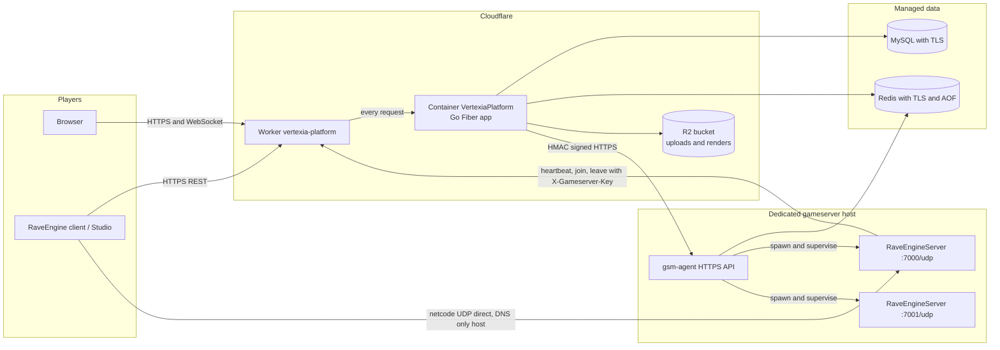
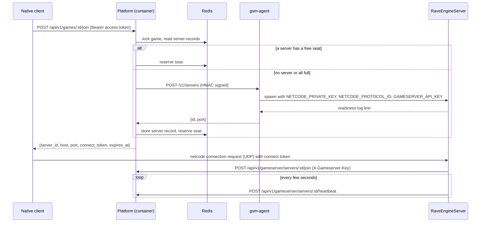

# VERTEXIA platform architecture

This document describes how the VERTEXIA platform (this repository) runs at
`https://vertexia.wempos-forum.com` and how real UDP multiplayer reaches the
native RaveEngine client. Deployment steps live in [DEPLOYMENT.md](DEPLOYMENT.md).

## Overview



## Request paths

* **Web and API traffic**: every HTTP request and WebSocket upgrade for
  `vertexia.wempos-forum.com` hits the Worker (`cloudflare/src/index.ts`),
  which forwards it unchanged (plus `X-Forwarded-For` from
  `CF-Connecting-IP`) to an instance of the `VertexiaPlatform` Container
  class. The container runs the Go binary built from the root `Dockerfile`.
* **Gameplay traffic**: UDP never touches Cloudflare. Cloudflare's proxy only
  carries HTTP(S)/WebSocket to Workers, so gameservers are reached through
  `games.vertexia.wempos-forum.com`, a DNS only (grey cloud) record pointing
  at the dedicated host.

## Joining a game



## Decisions

* **Container behind a Worker, not a VM.** The app is a long running Go
  server with WebSockets and image rendering. Cloudflare Containers run it
  unchanged while the Worker provides the custom domain, TLS and
  observability. The Worker holds no logic beyond forwarding.
* **All shared state in Redis.** Several container instances may run at once
  and any of them can be replaced at any time, so sessions, rate-limit
  counters, Studio/client authorization codes, access tokens, captcha replay
  protection, cooldowns, gameserver records and the feed WebSocket fan-out
  (pub/sub) live in Redis. With `APP_ENV=production` (or `REDIS_REQUIRED=true`)
  the app refuses to start without Redis and every memory fallback in
  `backend/kv` returns an error instead of silently keeping per-process state.
* **Persistent files in R2.** The container filesystem is ephemeral. Every
  runtime-written file (uploads, renders, thumbnails, generated assets, game
  files) goes through `backend/storage`, which keeps the existing relative
  paths as object keys (for example `static/uploads/games/7.png`). Local disk
  implements the same interface for development.
* **Gameservers on a dedicated host.** Raw UDP cannot be served from
  Cloudflare. `cmd/gsm-agent` runs on a Linux host, owns a UDP port range,
  spawns and supervises `RaveEngineServer` processes, restarts crashes a
  bounded number of times and persists its records in Redis so a restart
  reconciles running processes. The platform talks to it over HTTPS with
  HMAC-SHA256 request signatures (method, path, timestamp, nonce, body hash;
  30 second skew limit; nonces are single use).
* **Platform-minted netcode tokens.** Clients never receive a server secret.
  The platform mints a connect token in the exact format `lightyear_netcode`
  0.28 parses, with `NETCODE_PRIVATE_KEY`. The private part is sealed with
  XChaCha20-Poly1305 and carries the user id as `client_id`. `user_data`
  holds the user id (u64 little-endian at offset 0), then the server id length
  at byte 8 (at most 64) and the ASCII server id from byte 9. **All other
  integers in the token are big-endian**, unlike the netcode.io 1.02 spec, because
  that is what `lightyear_netcode` writes and reads. Only the platform and the
  gameservers know the key. A shared test vector
  (`tests/fixtures/connect_token_vector.json`, regenerate with
  `NETCODE_WRITE_VECTOR=1 go test ./backend/netcode -run TestWriteVector`)
  pins the byte layout across the Go and Rust implementations. Server
  addresses in the token come from `GSM_PUBLIC_IP` (comma list) when set,
  otherwise from a DNS lookup of `GSM_PUBLIC_HOST` (cached for one minute,
  IPv4 first). The token timeout is 15 seconds and its lifetime is
  `NETCODE_TOKEN_TTL` (default 60 seconds).
* **Short-lived opaque access tokens.** The Studio browser flow and the
  website "Play" button end in a one-time code exchanged for an opaque bearer
  token (`vxa_` prefix; 24 hours for the client, 7 days for Studio by
  default), stored only as a SHA-256 hash in Redis and revocable. A password
  change revokes every access token and remember-me cookie of the account.
  The long-lived account Unikey is no longer handed to clients. Legacy Unikey
  validation stays for gameservers and the shipped client during migration;
  headers (`X-Unikey`, `X-User-Key`) are preferred and the `?ukey=` query
  form is deprecated.
* **Gameserver key in headers only.** `GAMESERVER_API_KEY` is accepted only
  from request headers so it never lands in access logs or proxies.
* **CSRF by origin verification.** Cookie-authenticated state-changing
  requests must prove they come from the site itself through
  `Sec-Fetch-Site`, `Origin` or `Referer`; requests with explicit header
  credentials (Bearer tokens, gameserver key) are exempt because browsers
  cannot attach those cross-site without a CORS preflight the app never
  grants. The feed WebSocket handshake (a GET) checks `Origin` the same way.
* **Heartbeat eviction and idle scale-down.** Gameservers report heartbeats;
  a server that misses heartbeats for `GSM_HEARTBEAT_TIMEOUT` is stopped and
  forgotten, and empty servers drain after `GSM_IDLE_TIMEOUT`. Spawning is
  serialized per game with a Redis lock so concurrent container instances do
  not start duplicate servers, and `GSM_MAX_SERVERS` is enforced under a
  global Redis lock.

## Client contract

These are the HTTP shapes the RaveEngine client and Studio rely on.

* `POST /api/v1/auth/exchange` (client token by default) and
  `POST /api/v1/studio/exchange` (Studio token by default) take
  `{"code": "...", "client": "client"|"studio"}`; `client` overrides the token
  kind. `GET /api/v1/studio/exchange` was removed. The response is:

  ```json
  {"uid": 7, "username": "ann", "displayname": "Ann", "display_name": "Ann",
   "access_token": "vxa_...", "token_type": "Bearer", "token_kind": "client",
   "expires_at": 1795000000, "expires_in": 86400}
  ```

  It no longer contains `ukey`.
* `GET /api/v1/me` and `POST /api/v1/auth/logout` take `Authorization: Bearer`.
* `GET /api/v1/games` adds `thumbnail_url`, `players_online` and `next_page`;
  `GET /api/v1/games/:id` returns one game.
* `POST /api/v1/games/:id/join` (Bearer or browser session) returns
  `{server_id, host, port, connect_token, expires_at}` where `expires_at`
  is unix seconds and `connect_token` is base64. Browser-session callers also
  get `success`, `redirected`, `server` and `client_uri`. Errors: 404
  `{"error":"not_found"}`, 409 `{"error":"full"}`, 503
  `{"error":"unavailable"}` with `Retry-After: 5`.
* The website launches the client with
  `vertexia-client://play?game_id&server_id&host&ip&port&connect_token&expires_at&code&api`.
  `ip` repeats `host` for older clients. `code` is a one-time code (5 minute
  lifetime) for `/api/v1/auth/exchange`; the link never
  carries the Unikey. The client picks its platform origin from
  `VERTEXIA_API_DOMAIN` (or the legacy `VERTIGO_API_DOMAIN`), defaulting to
  `https://vertexia.wempos-forum.com`.

## Code map

| Area | Location |
| --- | --- |
| Startup, middleware, graceful shutdown | `main.go` |
| Configuration and validation | `backend/config` |
| Redis client, fiber.Storage, helpers | `backend/kv` |
| MySQL pool with verified TLS | `backend/database` |
| Object storage (R2 and local) | `backend/storage` |
| Access tokens, Studio auth | `backend/service/tokens.go`, `backend/service/studio_auth.go` |
| Netcode connect tokens | `backend/netcode` |
| Gameserver manager (local and remote) | `backend/service/gsm` |
| Agent protocol and HMAC auth | `backend/gsmagent` |
| Agent binary | `cmd/gsm-agent`, `deploy/gsm-agent` |
| Client API (`/api/v1/me`, games, join, auth) | `backend/handlers/api_auth.go`, `games.go`, `gsm.go`, `join.go` |
| Cloudflare Worker and Container | `cloudflare/`, `Dockerfile` |
